  

  

  
  
  

### About me

I'm an Automation Engineer who likes building things end to end, from embedded systems to web and mobile apps, with a bit of AI and a lot of attention to design.
Right now I'm building **[punch-app](https://github.com/horlesq/punch-app)** and maintaining **[gamelog](https://github.com/horlesq/gamelog)**.

### What I work on

<table>
  <tr>
    <td width="50%" valign="top">
      <b>Automation</b> 
      Workflows that remove repetitive work, built with n8n, Python and scripts running on my own server.
    </td>
    <td width="50%" valign="top">
      <b>Full-stack web</b> 
      Next.js and React frontends, with Node.js or FastAPI backends on PostgreSQL / Supabase.
    </td>
  </tr>
  <tr>
    <td width="50%" valign="top">
      <b>Mobile</b> 
      Cross-platform apps with Expo and React Native, like punch-app.
    </td>
    <td width="50%" valign="top">
      <b>AI and embedded</b> 
      LLM-powered features, NLP models with Hugging Face, and hardware-side tinkering.
    </td>
  </tr>
</table>

### Featured projects

| Project | What it is | Built with |
| --- | --- | --- |
| [punch-app](https://github.com/horlesq/punch-app) | Mobile app for employee time tracking, shift punch clock and payroll | Expo, React Native, Supabase |
| [gamelog](https://github.com/horlesq/gamelog) | Self-hosted app to track your video-game library | Next.js, Prisma, Docker |
| [hungry-seal](https://github.com/horlesq/hungry-seal) | Endless arcade game: swim, eat, dodge hazards, buy upgrades | Phaser, TypeScript, Vite |
| [cookbook-ai](https://github.com/horlesq/cookbook-ai) | Generates recipes from a description of what you want | Next.js, OpenAI, MongoDB |
| [sentiment-analysis](https://github.com/horlesq/sentiment-analysis) | Multilingual sentiment analysis app | React, FastAPI, Transformers |

### Stack & Tools

<table>
  <tr>
    <td><b>Frontend</b></td>
    <td>
      
      
      
    </td>
  </tr>
  <tr>
    <td><b>Mobile</b></td>
    <td>
      
    </td>
  </tr>
  <tr>
    <td><b>Backend</b></td>
    <td>
      
      
      
    </td>
  </tr>
  <tr>
    <td><b>Data</b></td>
    <td>
      
      
    </td>
  </tr>
  <tr>
    <td><b>Infra & automation</b></td>
    <td>
      
      
      
    </td>
  </tr>
</table>

  

