  

  

  
  
  

### 🏔️ About me

- ⚙️ Automation Engineer who likes software, embedded systems, AI and design
- 🔨 Currently building **[punch-app](https://github.com/horlesq/punch-app)** and maintaining **[gamelog](https://github.com/horlesq/gamelog)**
- 🏂 When I'm away from the keyboard, I'm probably on a snowboard

### ❄️ Featured projects

  
  
  
  

### 🧰 Stack & Tools

  
  
  
  
  
  
  
  
  
  
  
  

  

