  

  

  
  
  

### 🏔️ About me

  

  Currently building <b><a href="https://github.com/horlesq/punch-app">punch-app</a></b> and maintaining <b><a href="https://github.com/horlesq/gamelog">gamelog</a></b>

<!--### ❄️ Featured projects

 

  
  
  
  

 -->

### 🧰 Stack & Tools

  

  

